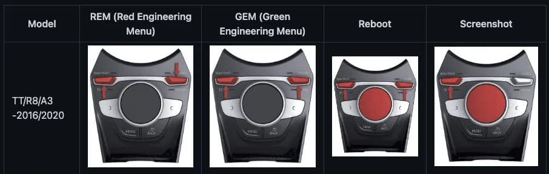
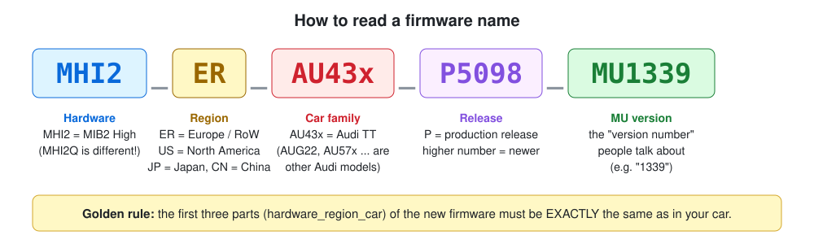
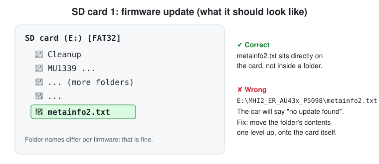

# Apple CarPlay & Android Auto on an Audi TT (8S): free DIY guide

A step-by-step guide to enabling **Apple CarPlay** and **Android Auto** on an **Audi TT / TTS / TT RS (8S, 2014–2023)** with the **MIB2 High (MHI2)** infotainment system, using only **SD cards and free tools**.

People pay **£200–£300** for this as a service. Usually that money goes to someone putting freely available software on SD cards and posting them to you. This guide gives you the same know-how for free.

> [!IMPORTANT]
> **Read the whole guide once before you start.** Most problems come from skipping a check or using a bad SD card.
> You do this **at your own risk**. If done carefully it is very safe, and the worst realistic outcome (power loss during an update) can usually be recovered. Still, nobody here is responsible for your car.

---

## Contents

1. [Does this work for my car?](#1-does-this-work-for-my-car)
2. [What you need](#2-what-you-need)
3. [Before you start: power, SD cards and the hidden menus](#3-before-you-start-power-sd-cards-and-the-hidden-menus)
4. [Step 1: Check your versions](#step-1-check-your-versions)
5. [Step 2: Update the MMI firmware](#step-2-update-the-mmi-firmware)
6. [Step 3: Update the Virtual Cockpit (only if below 0296)](#step-3-update-the-virtual-cockpit-only-if-below-0296)
7. [Step 4: Install M.I.B. and activate CarPlay / Android Auto](#step-4-install-mib-and-activate-carplay--android-auto)
8. [Step 5: Connect your phone](#step-5-connect-your-phone)
9. [Troubleshooting](#troubleshooting)
10. [Links and credits](#links-and-credits)

---

## 1. Does this work for my car?

Answer these three questions:

| Question | How to check | Needed |
|---|---|---|
| Is it an Audi TT, TTS or TT RS **8S** (Mk3, 2014–2023)? | Your registration papers, or the model year | Yes |
| Does it have **MMI Navigation plus** (map on the Virtual Cockpit)? | Press **NAV/MAP**. Do you get a map? | Yes |
| Does the firmware name start with **`MHI2_`**? | See [Step 1](#step-1-check-your-versions) | Yes |

- If the firmware name starts with **`MHI2_xx_AU43x_`**, this guide is for you.
- If it starts with something else (for example `MHI2Q_`, `MST2_`, `MHS2_`), **stop**. Your car has a different system and this guide does not apply.
- Already have CarPlay? Look in the MMI menu for **"Audi smartphone interface"**. If it is already there, you are done.

### Which firmware is right for my region?

The firmware must match your car's **region**. Use this table to know what to look for (versions known to work with M.I.B.):

| Your car is from | Your firmware starts with | Known target versions (pick the newest you can find) |
|---|---|---|
| Europe / UK / rest of world | `MHI2_ER_AU43x_` | `P5098_MU1339` (minimum for CarPlay), `P5151_MU1339`, `P5404_MU1479`, `P5406_MU1489` |
| USA / Canada | `MHI2_US_AU43x_` | `P5124_MU1389` (minimum for CarPlay), `K1083_MU1412`, `P5180_MU1462` |
| Japan | `MHI2_JP_AU43x_` | `P0902_MU0902` |
| China / Korea / other | `MHI2_CN_...` / `MHI2_KR_...` | Check the [M.I.B. compatibility table](https://github.com/Mr-MIBonk/M.I.B._More-Incredible-Bash/wiki/MHI2-M.I.B.-patch-FW-compatibility-table) |

Source: the [M.I.B. firmware compatibility table](https://github.com/Mr-MIBonk/M.I.B._More-Incredible-Bash/wiki/MHI2-M.I.B.-patch-FW-compatibility-table).

> [!CAUTION]
> **Never install firmware from another region or another car family.** An `ER` car gets `ER` firmware, a `US` car gets `US` firmware. `AUG22`, `AU57x` and others are for other Audi models, even if the name looks similar.

---

## 2. What you need

| Item | Cost | Notes |
|---|---|---|
| **2 × full-size SD cards**, 16 GB or 32 GB | ~€10 | Good brand (SanDisk, Samsung, Kingston). **Not** a microSD card in an adapter. Cheap or old cards are the #1 cause of problems. |
| **A Windows PC or Mac** with an SD card slot or reader | – | To prepare the SD cards. |
| **7-Zip** (free) | free | To unpack downloads: [7-zip.org](https://www.7-zip.org/) |
| **MMI firmware** for your car | free | From [mibvault.com](https://mibvault.com). See [Step 2](#step-2-update-the-mmi-firmware). |
| **Virtual Cockpit update** (only if needed) | free | From [mibvault.com](https://mibvault.com). See [Step 3](#step-3-update-the-virtual-cockpit-only-if-below-0296). |
| **M.I.B. – More Incredible Bash** | free | **https://github.com/Mr-MIBonk/M.I.B._More-Incredible-Bash** |
| **M.I.B. patch for your firmware** | free | From [mib.mibsolution.one](https://mib.mibsolution.one) (login: `guest` / `guest`) |
| **A USB cable** for your phone | – | Must carry **data**, not just charge. Use the original Apple/Android cable, or the Audi AMI cable if your car has the AMI connector. |
| Time | – | Plan **half a day**. Most of it is waiting. |

**You do NOT need:** VCDS, OBDeleven, a laptop in the car, or any paid service. Everything is done with the SD cards and the buttons in the car.

> [!WARNING]
> M.I.B. is free, open-source software. Its authors state: *"NOT FOR COMMERCIAL USE – IF YOU BOUGHT THIS YOU GOT RIPPED OFF."* If someone asks you for money for "the CarPlay software", this is what they are selling.

---

## 3. Before you start: power, SD cards and the hidden menus

### 3.1 Keep the battery healthy

An update takes a long time, and **the MMI must never lose power during an update**. Pick one of these:

- **Option A (best):** connect a **battery charger / maintainer** (5 A or more) for the whole process.
- **Option B:** **leave the car running** for the whole process, so the alternator keeps the battery charged. Many people, including the author of this guide, did it this way without problems. Do it outside or in a well-ventilated place, never in a closed garage.
  *Note: the M.I.B. developers say they do not recommend flashing with the engine running, so a charger is the safest choice if you have one.*

Also:
- Keep the **key inside the car**, close to the steering column.
- Close the doors and switch off the lights, A/C, seat heating and so on.
- **Don't** turn the car off, open/lock the car, or remove the SD card while an update is running.

### 3.2 Formatting an SD card

Each SD card must be **freshly formatted as FAT32** before you put files on it.

1. Put the SD card in your computer.
2. Open **File Explorer → This PC**.
3. **Right-click** the SD card → **Format…**
4. Set **File system** to **FAT32**.
5. Click **Start** → **OK**.

FAT32 not offered? The card is larger than 32 GB. Use a 16/32 GB card, or the free tool [Rufus](https://rufus.ie/) to format it as FAT32.
Mac: Disk Utility → Erase → Format **MS-DOS (FAT)**, Scheme **Master Boot Record**.

### 3.3 Where the SD slots are

The MMI unit's two SD card slots are in the **glovebox**. Always use slot **SD1** (the left one / the one marked "1").

<!-- TODO: add your own photo: images/tt-glovebox-sd-slots.jpg -->

### 3.4 The hidden menus (Red and Green Engineering Menu)

You'll use two hidden service menus. You open them by **pressing and holding two buttons at the same time for about 5 seconds** while you are on the **MMI home screen**.

| Menu | What it's for | Available |
|---|---|---|
| **Red Engineering Menu (REM)** | Reading versions, installing updates from SD | Always |
| **Green Engineering Menu (GEM)** | Running the M.I.B. tool | **Only after M.I.B. is installed** (Step 4) |
| **Reboot** | Restarting the MMI (hold the red-marked controls ~10 s) | Always |

Press the buttons highlighted in **red**, in the direction of the arrows. The picture above is for the TT (and R8/A3). Other Audi models use different combinations:

Key combinations for all Audi models (click to open)

Source: [M.I.B. wiki – hidden menus](https://github.com/Mr-MIBonk/M.I.B._More-Incredible-Bash/wiki).

**To leave a hidden menu:** press **BACK** a few times, or reboot the MMI.

---

## Step 1: Check your versions

You need **two version numbers** before downloading anything.

1. Start the car (or switch the ignition on) and wait until the MMI has fully started.
2. Go to the **home screen** and open the **Red Engineering Menu** (see [3.4](#34-the-hidden-menus-red-and-green-engineering-menu)).
3. Open the **version information** screen.
4. Write down (or **take a photo** of):
   - **The MMI firmware name.** Long text such as `MHI2_ER_AU43x_P4xxx_MU1xxx`. This is your **train**.
   - **The Virtual Cockpit (VC / instrument cluster) version.** A 4-digit number such as `0280` or `0296`.

You can also see the MMI version without the hidden menu under **MENU → Settings → System information / Version information**.

<!-- TODO: add your own photo: images/rem-version-screen.jpg -->

### How to read the firmware name

### What to do next

| Your situation | Next |
|---|---|
| MU version **lower** than the target for your region (see [the table](#which-firmware-is-right-for-my-region)) | Do **Step 2** |
| MU version is already the target or higher | Skip to **Step 3** |
| Virtual Cockpit version **lower than 0296** | You will also need **Step 3** |
| Virtual Cockpit version **0296 or higher** | You can skip **Step 3** |

---

## Step 2: Update the MMI firmware

**Time:** about 45–90 minutes in the car. **SD card:** #1.

### 2.1 Download the firmware

1. Go to **[mibvault.com](https://mibvault.com)**.
2. Search using your **region and car family** plus the **target version**, for example:

   | Your car | Search for |
   |---|---|
   | Europe / UK | `MHI2_ER_AU43x` or `1339` |
   | USA / Canada | `MHI2_US_AU43x` or `1389` / `1462` |
   | Japan | `MHI2_JP_AU43x` |

   Example: [mibvault.com/search?q=1339](https://mibvault.com/search?q=1339)

   

3. Check the result before you download it:
   - The **name** starts exactly the same as your car's firmware. For a European TT that's **`MHI2_ER_AU43x_P5098_MU1339 (TT).7z`**.
   - The labels say **MIB2 High**, **Brand: Audi**, and the right **Region** (for example *Europe/ROW*).
   - A green **"Flashed OK on MIB2 High"** label means other people have installed this file successfully.
   - Too many results? Use the **Head unit**, **Brand** and **Region** filters at the top.
4. Click **Download** on the right. The file is large (about **2 GB**, in **.7z** format), so it can take a while.

> [!CAUTION]
> Check the first part of the name **three times**: `MHI2` + region (`ER`/`US`/`JP`...) + `AU43x` must match your car exactly.

### 2.2 Put the firmware on SD card #1

1. **Format** SD card #1 as FAT32 ([3.2](#32-formatting-an-sd-card)).
2. Unpack the downloaded file with **7-Zip**: right-click → *7-Zip* → *Extract here*.
3. Copy the **contents** onto the SD card so that the file **`metainfo2.txt`** is **directly on the card**, not inside a folder:

4. Use **"Eject"** in Windows before removing the card.

### 2.3 Install it in the car

1. Make sure the battery is taken care of ([3.1](#31-keep-the-battery-healthy)).
2. Insert SD card #1 into slot **SD1** in the glovebox.
3. Open the **Red Engineering Menu**.
4. Choose **Update** (software update) → select the **SD card** as the source.
5. The MMI shows the update package. Choose **Standard**, or:
   - **If your car has a Bose sound system:** choose the custom/user-defined option and **untick "Bose"** (the amplifier), then start. Bang & Olufsen does not need this.
6. Confirm and **start** the update.
7. **Wait.** The screen goes black, the MMI restarts several times, and progress bars come and go. This is normal. **Do not touch anything.**
8. At the end you get a summary. Everything should be marked as successful / **Y**. Leave the menu with BACK.
9. Remove the SD card. Check the new version (Step 1). It should now show your target version, for example `P5098 / MU1339`.

> [!TIP]
> Error **"FPK:0 error code 142"**? Put the car key close to the steering column (where the emergency key spot is), then try again.

---

## Step 3: Update the Virtual Cockpit (only if below 0296)

In the TT, CarPlay and Android Auto are shown on the **Virtual Cockpit**. The Virtual Cockpit needs software version **0296 or higher** to show them. If yours is already 0296+, **skip this step**.

**Time:** about 15–30 minutes. **SD card:** #1 again (re-formatted).

1. On [mibvault.com](https://mibvault.com), search for **`0296`**, **`Virtual Cockpit`** or **`8S0906961`** (the part number family of the TT 8S Virtual Cockpit).
2. Download the Virtual Cockpit update for **your** car (region, and pre-facelift / facelift if listed).
3. **Format** SD card #1 again and unpack the update onto it the same way as in [2.2](#22-put-the-firmware-on-sd-card-1). Again, **`metainfo2.txt` must be directly on the card**.
4. In the car: insert into **SD1** → **Red Engineering Menu** → **Update** → **SD card** → start.
5. Wait until it is finished. The instrument cluster may go dark and restart. **Do not switch the car off.**
6. Check in the Red Engineering Menu that the Virtual Cockpit now shows **0296** (or higher).

---

## Step 4: Install M.I.B. and activate CarPlay / Android Auto

The firmware update alone **does not** switch on CarPlay/Android Auto. The free **M.I.B.** tool does that. It installs itself, unlocks the Green Engineering Menu, and patches your MMI so CarPlay and Android Auto are enabled.

**Time:** about 20–30 minutes. **SD card:** #2.

### 4.1 Download M.I.B. and the patch

1. **M.I.B.:** go to **https://github.com/Mr-MIBonk/M.I.B._More-Incredible-Bash/releases** and download the **latest release** ("Source code (zip)" under *Assets*).
2. **Patch collection:** go to **https://mib.mibsolution.one** (log in with user **`guest`**, password **`guest`**) and download the patch collection. You only need the folder that matches your firmware name exactly, for example:
   `MHI2_ER_AU43x_P5098_MU1339_PATCH`

   *mibsolution can be slow. The M.I.B. wiki links a [faster download mirror](https://mibwiki.one/share/99dda9a7-06e2-4673-a5df-2ea7e0eb18cb).*

### 4.2 Prepare SD card #2

1. **Format** SD card #2 as FAT32 ([3.2](#32-formatting-an-sd-card)).
2. Unpack the M.I.B. zip. Open the folder inside it and copy **everything** onto the SD card. Again, **`metainfo2.txt` must be directly on the card**.
3. Copy the patch folder for **your** firmware into the **`patches`** folder on the SD card.
4. *(Optional, makes installing automatic)* Rename the file **`_Swdlautorun.txt`** to **`Swdlautorun.txt`** (remove the underscore).

### 4.3 Install M.I.B. in the car

1. Battery taken care of ([3.1](#31-keep-the-battery-healthy)).
2. Insert SD card #2 into slot **SD1**. **Leave it in from now on.** M.I.B. only works while its card is in SD1.
3. Install:
   - **If you renamed `Swdlautorun.txt`:** just wait. Within about a minute the MMI restarts into update mode by itself.
   - **Otherwise:** open the **Red Engineering Menu** → **Update** → **SD card** → select **"M.I.B. Launcher"** → **Start**.

   

4. The MMI **restarts about three times** (5–10 minutes). Don't touch anything.
5. At the end you see a summary with *Launcher: Y*. Go back. When a screen asks something like **"Start diagnostic tester…"**, press **Cancel**.

### 4.4 Run M.I.B. from the Green Engineering Menu

1. Wait until the MMI has fully started. **The Green Menu can take up to 5 minutes** to become available after a restart.
2. Open the **Green Engineering Menu** with the GEM key combination ([3.4](#34-the-hidden-menus-red-and-green-engineering-menu)).
3. Use the **rotary knob** to scroll and **press** it to select. Choose **`==>>m.i.b<<==`**.

   

4. **Make a backup first.** Choose **Backup** and run it. It saves a copy of your MMI's original files to the SD card. Wait until it says it's done.

   

5. **Run the patch.** Go to the **Patch** menu and run the **all-in-one (AIO) patch** ("Patch IFS-root-AIO"). This patches the firmware, adds the CarPlay and Android Auto feature codes (FECs) and activates them.

   

   

6. Follow the questions on screen (confirm with the knob). The MMI reboots when it's finished.
7. **Copy the backup to your computer.** Take SD card #2 out, copy the **`backup`** folder to your PC and keep it safe. Then you can format the card for other use.

> [!NOTE]
> No VCDS or OBDeleven coding is needed: M.I.B. takes care of activation.

---

## Step 5: Connect your phone

1. Start the car and wait for the MMI to boot.
2. Connect your phone with a **data USB cable** to the car's USB / AMI port.
3. **iPhone:** unlock the phone and allow CarPlay when asked (Settings → General → CarPlay).
   **Android:** make sure the **Android Auto** app is installed and updated, unlock the phone and follow the prompts.
4. In the MMI menu you'll now find **"Audi smartphone interface"**, and CarPlay / Android Auto appears on the Virtual Cockpit. 🎉

---

## Troubleshooting

| Problem | Solution |
|---|---|
| **"No update found" / SD card not recognised** | `metainfo2.txt` is not directly on the card, or the card is not FAT32. Re-format and copy again. Try **another SD card**. Bad cards are the #1 issue. Use slot **SD1**. |
| **Error FPK:0 / error code 142** | Put the key near the steering column and retry. |
| **Update seems stuck / black screen** | Be patient: some stages take 20+ minutes without visible progress. If nothing happens for over an hour, reboot the MMI (hold the reboot combination ~10 s). As a last resort, pull the MMI fuse or disconnect the battery briefly. |
| **Power was lost during an update** | Don't panic: this can usually be recovered. Re-insert the SD card and start the update again. Ask for help (see below) with your M.I.B. `backup` folder. |
| **Green Engineering Menu doesn't open** | It only exists **after** M.I.B. is installed, and needs up to 5 minutes after the MMI starts. Check you're on the home screen. |
| **"m.i.b" not visible in the Green Menu** | M.I.B.'s SD card must be in **SD1**. |
| **No patch found for my firmware** | Check that the patch folder name matches your firmware name exactly and is inside `patches`. If none exists for your version, update to a version that has one (Step 2). |
| **"Audi smartphone interface" not visible** | Re-check the Virtual Cockpit version (0296+), reboot the MMI, and re-run the M.I.B. patch. Some forum guides mention extra 5F coding with OBDeleven/VCDS as a last resort, but it's normally not needed. |
| **Phone connects for charging only** | Use a different cable (data capable), or the other USB port. Check you're using a port that is connected to the MMI (it should also play music over USB). |
| **SVM error in the 5F module (seen with a diagnostic tool)** | Run **"SVM fix"** in M.I.B. |

**Need help?** The M.I.B. community: [M.I.B. wiki](https://github.com/Mr-MIBonk/M.I.B._More-Incredible-Bash/wiki), [Get help page](https://github.com/Mr-MIBonk/M.I.B._More-Incredible-Bash/wiki/Get-help), [mibwiki.one](https://mibwiki.one), and the [TT Forum firmware FAQ](https://www.ttforum.co.uk/threads/faq-audi-tt-mk3-8s-firmware-updates.1970533/). Always include your firmware name and the M.I.B. log (`backup/logs` on the SD card).

---

## Links and credits

| What | Link |
|---|---|
| **M.I.B. – More Incredible Bash** (the tool) | https://github.com/Mr-MIBonk/M.I.B._More-Incredible-Bash |
| M.I.B. releases (download) | https://github.com/Mr-MIBonk/M.I.B._More-Incredible-Bash/releases |
| M.I.B. wiki | https://github.com/Mr-MIBonk/M.I.B._More-Incredible-Bash/wiki |
| M.I.B. patches (`guest`/`guest`) | https://mib.mibsolution.one |
| Firmware & Virtual Cockpit downloads | https://mibvault.com |
| 7-Zip | https://www.7-zip.org |
| Rufus (format large cards as FAT32) | https://rufus.ie |
| M.I.B. Audi video guide | https://www.youtube.com/watch?v=eAQgzYlnSrA |

All credit for the M.I.B. tool goes to **Mr-MIBonk and the M.I.B. team**. Screenshots of M.I.B. menus are from the M.I.B. wiki. This repository does not host any firmware or software; it only explains how to use freely available tools.

*Found a mistake or got it working on a different model/region? Open an issue or pull request so this guide stays useful for everyone.*
