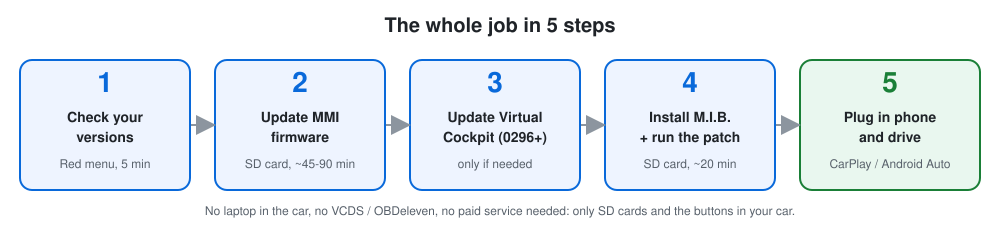
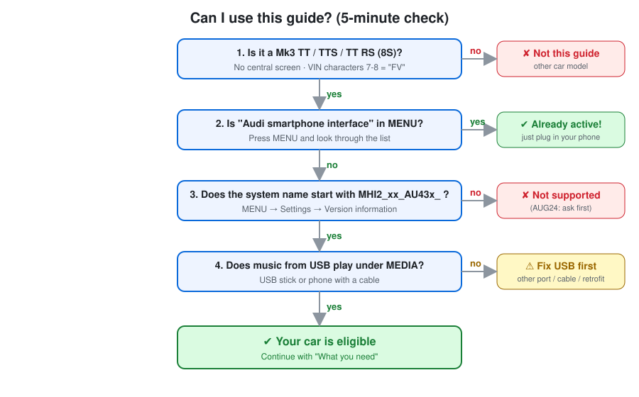
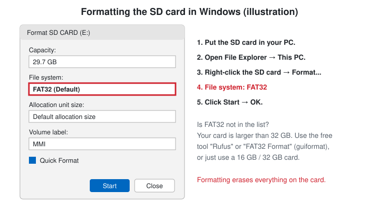
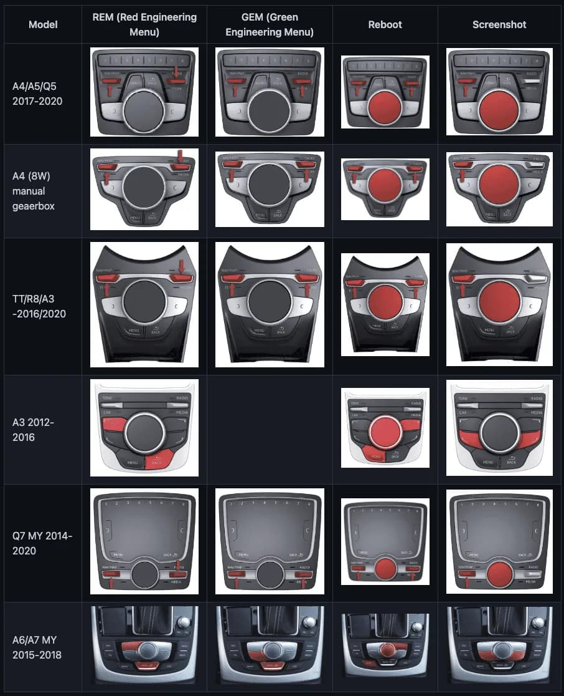
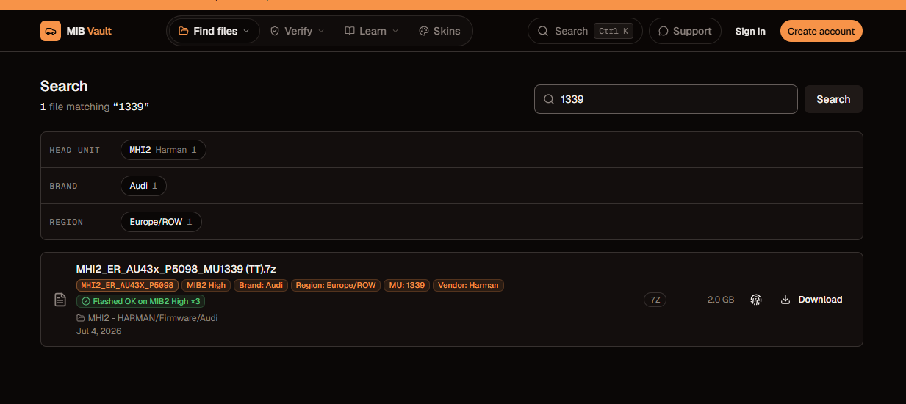
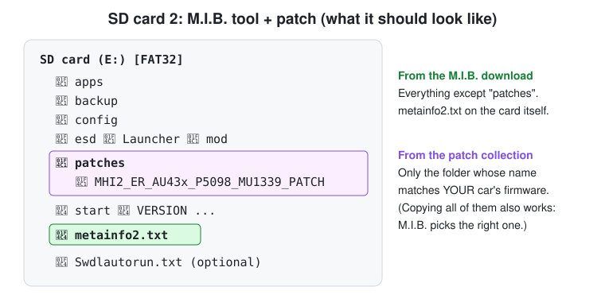

# Apple CarPlay & Android Auto on Audi MIB2 High (MHI2): free DIY guide

A step-by-step guide to enabling **Apple CarPlay** and **Android Auto** on **every Audi with the MIB2 High (MHI2 / MHI2Q) infotainment system**, using only **SD cards and free tools**:

**A3 / S3 / RS3 (8V) · Q2 · TT / TTS / TT RS (8S) · R8 (4S) · A4 (B9) · A5 (F5) · Q5 (FY) · Q7 (4M) · A6 / A7 (C7)**, roughly model years **2015–2020**, in Europe, the US and other regions.

People pay **£200–£300** for this as a service. Usually that money goes to someone putting freely available software on SD cards and posting them to you. This guide gives you the same know-how for free.

> [!NOTE]
> **This gives you wired CarPlay / Android Auto**: your phone connects with a USB cable. Want it **wireless**? Do this guide first, then add a wireless adapter (see [Going wireless](#going-wireless-optional)).

> [!IMPORTANT]
> **Read the whole guide once before you start.** Most problems come from skipping a check or using a bad SD card.
> You do this **at your own risk**. If done carefully it is very safe, and the worst realistic outcome (power loss during an update) can usually be recovered. Still, nobody here is responsible for your car.

---

## Contents

1. [Does this work for my car?](#1-does-this-work-for-my-car)
2. [Which firmware file do I need?](#2-which-firmware-file-do-i-need)
3. [What you need](#3-what-you-need)
4. [Before you start: power, SD cards and the hidden menus](#4-before-you-start-power-sd-cards-and-the-hidden-menus)
5. [Step 1: Check your versions](#step-1-check-your-versions)
6. [Step 2: Update the MMI firmware](#step-2-update-the-mmi-firmware)
7. [Step 3: Update the Virtual Cockpit (TT and R8 only)](#step-3-update-the-virtual-cockpit-tt-and-r8-only)
8. [Step 4: Install M.I.B. and activate CarPlay / Android Auto](#step-4-install-mib-and-activate-carplay--android-auto)
9. [Step 5: Connect your phone](#step-5-connect-your-phone)
10. [Troubleshooting](#troubleshooting)
11. [Links and credits](#links-and-credits)

---

## 1. Does this work for my car?

Takes about **5 minutes**, sitting in your car. You don't need tools, a laptop or the hidden menus for this.

### Check 1: Is your Audi on the list?

These Audis were sold with **MMI Navigation plus on MIB2 High**:

| Model | Generation | Approx. years | VIN characters 7–8 | Where CarPlay appears |
|---|---|---|---|---|
| A3 / S3 / RS3 | 8V (facelift) | 2016–2020 | `8V` | MMI screen |
| Q2 | GA | 2016–2020 | `GA` | MMI screen |
| TT / TTS / TT RS | 8S (Mk3) | 2014–2023 | `FV` | **Virtual Cockpit** (no central screen) |
| R8 | 4S (Mk2) | 2015–2023 | `4S` | **Virtual Cockpit** (no central screen) |
| A4 / S4 / RS4 | B9 (pre-facelift) | 2016–2019 | `8W` | MMI screen |
| A5 / S5 / RS5 | F5 (pre-facelift) | 2017–2019 | `F5` | MMI screen |
| Q5 / SQ5 | FY (pre-facelift) | 2017–2020 | `FY` | MMI screen |
| Q7 / SQ7 | 4M (pre-facelift) | 2016–2019 | `4M` | MMI screen |
| A6 / A7 | C7 (facelift) | 2015–2018 | `4G` | MMI screen |

- **The VIN** (vehicle identification number) is on your registration papers and at the bottom of the windscreen. Characters 7 and 8 give the model, for example `WAUZZZ`**`8V`**`…` = A3 8V.
- **Years are approximate** and differ by country. The model years and options are only a hint: **Check 3 is what really decides it.**
- **Not covered:** older A3s with MIB1 (2012–2016 pre-facelift), and newer models with **MIB3** or **MIB2+** (A1, A4/A5 2020+, A6/A7/A8 C8/D5, Q3 2019+, Q8, e-tron...). Most of those have CarPlay from the factory.

### Check 2: Do you already have CarPlay?

1. Press **MENU** on the MMI controls.
2. Look for **"Audi smartphone interface"** (sometimes just **"Smartphone"**).

- **Found it?** CarPlay / Android Auto is already active. Plug in your phone with a USB cable; **you don't need this guide**.
- **Not there?** Continue with Check 3.

### Check 3: Does it have MIB2 High (MHI2)?

CarPlay through this guide only works on the **MIB2 High** system, also called **MHI2** (or **MHI2Q** on some A4/A5/Q5/Q7). That's the system that comes with **MMI Navigation plus**. There are two ways to check:

**A. Quick check: do you have navigation?**

1. Press **NAV/MAP**.
2. Do you get a **full map** (with the option to enter a destination)?

- **Yes:** you probably have MHI2. Go to B to be 100% sure.
- **No map:** you probably have a smaller system (MIB2 Standard). Check B anyway: if the name doesn't start with `MHI2`, **this guide doesn't work for your car**.

**B. Sure check: read the system name (recommended)**

1. Press **MENU** → **Settings** (on some versions: *Setup MMI* or *System*) → **Version information** (or *System information*).
2. Look for a long code such as `MHI2_ER_AU43x_P4204_MU1169`.

Can't find it in the normal menu? Use the **Red Engineering Menu** instead (see [4.4](#44-the-hidden-menus-red-and-green-engineering-menu)) → **Version information**. It's always shown there.

**What does the name mean?**

| The name starts with… | What you have | Can you use this guide? |
|---|---|---|
| `MHI2_` | MIB2 High | ✅ **Yes** |
| `MHI2Q_` | MIB2 High "Q" (A4/A5/Q5/Q7) | ✅ **Yes** |
| `MHI2_ER_AUG24_` | MIB2 High, very early TT | ⚠️ **Ask first**, see the [firmware notes](#2-which-firmware-file-do-i-need) |
| `MHIG_...` | MIB1 High (older A3 and others) | ❌ No. No CarPlay possible with this method |
| `MST2_...`, `MHS2_...`, `MH2P_...` or anything else | **Not** MIB2 High | ❌ No. M.I.B. does not work on these systems |

> [!TIP]
> **Take a photo of this screen.** You'll need the exact name again in [Step 1](#step-1-check-your-versions) and to pick the right download.

### Check 4: Does your USB port carry data?

CarPlay and Android Auto need a USB connection **to the MMI**, not just a charging port.

1. Put some music on a USB stick (or connect your phone with a cable).
2. Plug it into the car's USB / AMI port.
3. Press **MEDIA**. Can you select the USB stick / phone as a source and play music?

- **Yes:** ✅ your port works for CarPlay.
- **No / it only charges:** try the other port (if you have one) or a different cable. If no port shows up under MEDIA, your car may need a USB / AMI retrofit first; ask in a forum for your model (see [Troubleshooting](#troubleshooting)).

### Result

| Check | Needed |
|---|---|
| 1. Your Audi is on the list | ✅ |
| 2. No "Audi smartphone interface" yet | ✅ (otherwise you're already done) |
| 3. System name starts with `MHI2_` or `MHI2Q_` | ✅ |
| 4. USB port plays media | ✅ |

**All four OK?** This guide is for you. Continue with [Which firmware file do I need?](#2-which-firmware-file-do-i-need)

---

## 2. Which firmware file do I need?

**There is no conversion table to look up.** Your car tells you directly: the MMI shows its own firmware name ([Step 1](#step-1-check-your-versions)), and the files on mibvault are named the same way. You only need to match them.

### How to read a firmware name

**Recipe:**

1. Read your firmware name in the car, for example `MHI2_ER_AU43x_P4204_MU1169`.
2. Keep only the **first three parts**: `MHI2_ER_AU43x`. This is your **family**.
3. Find that family in the table below and use the **recommended version**.

### Recommended firmware per family

These are the newest versions that the M.I.B. tool supports (source: the [M.I.B. compatibility table](https://github.com/Mr-MIBonk/M.I.B._More-Incredible-Bash/wiki/MHI2-M.I.B.-patch-FW-compatibility-table)), and the files we've seen on [mibvault](https://mibvault.com) (November 2026).

**Europe / UK / rest of world (`_ER_`)**

| Your family | Models | Recommended version | Seen on mibvault |
|---|---|---|---|
| `MHI2_ER_AU37x` | A3 / S3 / RS3 | `P5153_MU1326` or `P5089_MU1326` | `MHI2_ER_AU37x_P4203_MU1168 (A3).7z` (older, but supported) |
| `MHI2_ER_AU276` | Q2 | `P5510_MU1477` | – (search `AU276`) |
| `MHI2_ER_AU43x` | TT / TTS / TT RS | **`P5098_MU1339`** | ✅ `MHI2_ER_AU43x_P5098_MU1339 (TT).7z` (*Flashed OK ×3*) |
| `MHI2_ER_AU62x` | R8 | `P5099_MU1340` | Only older ones: `K3331_MU1028 (R8)`, `K1078_MU0916 (R8)` |
| `MHI2_ER_AUG22` | A4 / A5 / Q5 / Q7 | `K3344_MU1438` or `K3346_MU1438` | ✅ `MHI2_ER_AUG22_K3344_MU1438 (A4-A5-Q5-Q7).7z` (*Flashed OK*), `…_K3346_MU1438 (A4-A5-Q5-Q7).7z` |
| `MHI2Q_ER_AUG22` | A4 / A5 / Q5 / Q7 ("Q" unit) | `P5092_MU1329` | ✅ `MHI2Q_ER_AUG22_P5092_MU1329 (A4-A5-Q5-Q7).7z` (*Flashed OK ×4*) |
| `MHI2_ER_AU57x` | A6 / A7 | `K2589_MU1429` | ✅ `MHI2_ER_AU57x_K2589_MU1429 (A6-A7).7z` |

**USA / Canada (`_US_`)**

| Your family | Models | Recommended version | Seen on mibvault |
|---|---|---|---|
| `MHI2_US_AU37x` | A3 / S3 / RS3 | `K5512_1_MU1484` | ✅ `MHI2_US_AU37x_K5512_1_MU1484 (A3).7z` (*Flashed OK*) |
| `MHI2_US_AU276` | Q2 | `P5083_MU1312` | ✅ `MHI2_US_AU276_P5083_MU1312 (Q2).7z` |
| `MHI2_US_AU43x` | TT / TTS / TT RS | `P5180_MU1462` (minimum for CarPlay: `P5124_MU1389`) | ✅ `MHI2_US_AU43x_P5180_MU1462_4M0906961EK.7z`, `MHI2_US_AU43x_P5124_MU1389 (TT).7z` |
| `MHI2_US_AU62x` | R8 | `P5181_MU1463` | ✅ `MHI2_US_AU62x_P5181_MU1463_4M0906961EL.7z` |
| `MHI2_US_AUG22` | A4 / A5 / Q5 / Q7 | `K3347_MU1439` or `K3345_MU1439` | ✅ `MHI2_US_AUG22_K3347_MU1439 (A4-A5-Q5-Q7).7z`, `…_K3345_MU1439 (A4-A5-Q5-Q7) 4M0906961CQ.7z` |
| `MHI2Q_US_AUG22` | A4 / A5 / Q5 / Q7 ("Q" unit) | `P5087_MU1316` | ✅ `MHI2Q_US_AUG22_P5087_MU1316 (A4-A5-Q5-Q7).7z` |
| `MHI2_US_AU57x` | A6 / A7 | `K3341_MU1426` | ✅ `MHI2_US_AU57x_K3341_MU1426.7z` |

**Other regions (`_JP_`, `_CN_`, `_KR_`, `_TW_`)**: check the [M.I.B. compatibility table](https://github.com/Mr-MIBonk/M.I.B._More-Incredible-Bash/wiki/MHI2-M.I.B.-patch-FW-compatibility-table) for the versions supported for your family (for example `MHI2_JP_AU43x_P0902_MU0902` for a Japanese TT).

### Important notes

- **Already on the recommended version (or a newer one from the M.I.B. table)?** You can **skip Step 2**.
- **"MU" = the version number.** Higher means newer. Only go **up** to a file with a higher MU than you have now; never install an older one.
- **Two options in one row** (for example `K3344` or `K3346`)? Both are fine for that family. If the car refuses one, use the other.
- **The extra code at the end** of some file names (for example `4M0906961EK`) is Audi's **software part number** for that firmware. You don't need to match it.
- **The recommended version isn't on mibvault?** Pick the newest version **for your family** that *is* on mibvault **and** in the [M.I.B. table](https://github.com/Mr-MIBonk/M.I.B._More-Incredible-Bash/wiki/MHI2-M.I.B.-patch-FW-compatibility-table). M.I.B. needs a patch for exactly that version.
- **Early TTs showing `AUG24`:** mibvault marks `MHI2_ER_AUG24_K1068_MU0364 (TT)` as TT firmware, but it's very old, and I couldn't confirm whether these cars can go straight to `AU43x`. Ask in the [TT Forum firmware FAQ](https://www.ttforum.co.uk/threads/faq-audi-tt-mk3-8s-firmware-updates.1970533/) before flashing.
- **Built-in safety net:** the MMI checks the update before installing. If you put a wrong file on the card, it will usually say the update is not valid or not compatible. Treat that as a "stop", and **don't** rely on it instead of checking the name yourself.

> [!CAUTION]
> **The first three parts must match exactly.**
> - Same **hardware**: `MHI2` stays `MHI2`, `MHI2Q` stays `MHI2Q`. **Never swap between them.**
> - Same **region**: an `ER` car gets `ER` firmware, a `US` car gets `US` firmware.
> - Same **family**: `AU37x` (A3), `AU276` (Q2), `AU43x` (TT), `AU62x` (R8), `AUG22` (A4/A5/Q5/Q7), `AU57x` (A6/A7). Files for VW/Škoda/SEAT/Porsche (`VWG`, `SKG`, `SEG`, `POG`) are **never** for an Audi.

---

## 3. What you need

| Item | Cost | Notes |
|---|---|---|
| **2 × full-size SD cards**, 16 GB or 32 GB | ~€10 | Good brand (SanDisk, Samsung, Kingston). **Not** a microSD card in an adapter. Cheap or old cards are the #1 cause of problems. |
| **A Windows PC or Mac** with an SD card slot or reader | – | To prepare the SD cards. |
| **7-Zip** (free) | free | To unpack downloads: [7-zip.org](https://www.7-zip.org/) |
| **MMI firmware** for your car | free | From [mibvault.com](https://mibvault.com). See [Step 2](#step-2-update-the-mmi-firmware). |
| **Virtual Cockpit update** (TT/R8, only if needed) | free | From [mibvault.com](https://mibvault.com). See [Step 3](#step-3-update-the-virtual-cockpit-tt-and-r8-only). |
| **M.I.B. – More Incredible Bash** | free | **https://github.com/Mr-MIBonk/M.I.B._More-Incredible-Bash** |
| **M.I.B. patch for your firmware** | free | From [mib.mibsolution.one](https://mib.mibsolution.one) (login: `guest` / `guest`) |
| **A USB cable** for your phone | – | Must carry **data**, not just charge. Use the original Apple/Android cable, or the Audi AMI cable if your car has the AMI connector. |
| *Optional:* wireless adapter | paid | Only if you want **wireless** CarPlay / Android Auto, see [Going wireless](#going-wireless-optional). |
| Time | – | Plan **half a day**. Most of it is waiting. |

**You do NOT need:** VCDS, OBDeleven, a laptop in the car, or any paid service. Everything is done with the SD cards and the buttons in the car.

> [!WARNING]
> M.I.B. is free, open-source software. Its authors state: *"NOT FOR COMMERCIAL USE – IF YOU BOUGHT THIS YOU GOT RIPPED OFF."* If someone asks you for money for "the CarPlay software", this is what they are selling.

---

## 4. Before you start: power, SD cards and the hidden menus

### 4.1 Keep the battery healthy

An update takes a long time, and **the MMI must never lose power during an update**. Pick one of these:

- **Option A (best):** connect a **battery charger / maintainer** (5 A or more) for the whole process.
- **Option B:** **leave the car running** for the whole process, so the alternator keeps the battery charged. Many people, including the author of this guide, did it this way without problems. Do it outside or in a well-ventilated place, never in a closed garage.
  *Note: the M.I.B. developers say they do not recommend flashing with the engine running, so a charger is the safest choice if you have one.*

Also:
- Keep the **key inside the car**, close to the steering column.
- Close the doors and switch off the lights, A/C, seat heating and so on.
- **Don't** turn the car off, open/lock the car, or remove the SD card while an update is running.

### 4.2 Formatting an SD card

Each SD card must be **freshly formatted as FAT32** before you put files on it.

1. Put the SD card in your computer.
2. Open **File Explorer → This PC**.
3. **Right-click** the SD card → **Format…**
4. Set **File system** to **FAT32**.
5. Click **Start** → **OK**.

FAT32 not offered? The card is larger than 32 GB. Use a 16/32 GB card, or the free tool [Rufus](https://rufus.ie/) to format it as FAT32.
Mac: Disk Utility → Erase → Format **MS-DOS (FAT)**, Scheme **Master Boot Record**.

### 4.3 Where the SD slots are

The MMI has **two SD card slots**, labelled **SD1** and **SD2**. On most models they are in the **glovebox**. Always use slot **SD1** (usually the left one).

<!-- TODO: add your own photo: images/tt-glovebox-sd-slots.jpg -->

### 4.4 The hidden menus (Red and Green Engineering Menu)

You'll use two hidden service menus. You open them by **pressing and holding two buttons at the same time for about 5 seconds** while you are on the **MMI home screen**.

| Menu | What it's for | Available |
|---|---|---|
| **Red Engineering Menu (REM)** | Reading versions, installing updates from SD | Always |
| **Green Engineering Menu (GEM)** | Running the M.I.B. tool | **Only after M.I.B. is installed** (Step 4) |
| **Reboot** | Restarting the MMI (hold ~10 s) | Always |

Find the row for **your model** and press the buttons highlighted in **red**, in the direction of the arrows:

| Your car | Row to use |
|---|---|
| TT, R8, A3 / S3 / RS3 (2016+), Q2 | **"TT/R8/A3 -2016/2020"**. On the TT, the Red Engineering Menu is **NAV/MAP up + RADIO down**. |
| A4 / A5 / Q5 (automatic) | **"A4/A5/Q5 2017-2020"** |
| A4 with manual gearbox | **"A4 (8W) manual gearbox"** |
| Q7 | **"Q7 MY 2014-2020"** |
| A6 / A7 | **"A6/A7 MY 2015-2018"** |
| A3 2012–2016 | Older MIB1 system, **not supported** by this guide (that's why it has no green menu) |

Source: [M.I.B. wiki – hidden menus](https://github.com/Mr-MIBonk/M.I.B._More-Incredible-Bash/wiki).

**To leave a hidden menu:** press **BACK** a few times, or reboot the MMI.

---

## Step 1: Check your versions

1. Start the car (or switch the ignition on) and wait until the MMI has fully started.
2. Go to the **home screen** and open the **Red Engineering Menu** (see [4.4](#44-the-hidden-menus-red-and-green-engineering-menu)).
3. Open the **version information** screen.
4. Write down (or **take a photo** of):
   - **The MMI firmware name (all cars).** Long text such as `MHI2_ER_AU43x_P4204_MU1169`. This is your **train**. Sometimes it's shown in two pieces (for example `MHI2_ER_AU43x_P4204` and, elsewhere, `MU1169`). Write down both.
   - **TT and R8 only: the Virtual Cockpit (VC / instrument cluster) version.** A 4-digit number such as `0280` or `0296`.

   

   *Example from the M.I.B. wiki; the screen looks slightly different per model.*

You can also see the MMI version without the hidden menu under **MENU → Settings → System information / Version information**. The exact wording depends on your current version and language.

<!-- TODO: add your own photo: images/rem-version-screen.jpg -->

### What to do next

**MMI firmware (all cars)**, compare with [the recommended version for your family](#recommended-firmware-per-family):

| Your situation | Next |
|---|---|
| Your MU version is **lower** than the recommended one | Do **[Step 2](#step-2-update-the-mmi-firmware)** |
| You're already on the recommended version (or a newer one from the M.I.B. table) | Skip Step 2 |

**Virtual Cockpit**:

| Your car | Virtual Cockpit version | Next |
|---|---|---|
| **TT** | **lower than 0296** | Do **[Step 3](#step-3-update-the-virtual-cockpit-tt-and-r8-only)** after Step 2 |
| **TT** | **0296 or higher** | ✅ **Skip Step 3, go straight to [Step 4](#step-4-install-mib-and-activate-carplay--android-auto)** |
| **R8** | any | Skip Step 3 for now. Only come back to it if CarPlay doesn't show up after Step 4 (see [Step 3](#step-3-update-the-virtual-cockpit-tt-and-r8-only)) |
| **All other models** (A3, Q2, A4, A5, Q5, Q7, A6, A7) | not relevant | ✅ **Skip Step 3, go straight to [Step 4](#step-4-install-mib-and-activate-carplay--android-auto)**. CarPlay is shown on the MMI screen, not in the cockpit |

---

## Step 2: Update the MMI firmware

**Time:** about 45–90 minutes in the car. **SD card:** #1.

### 2.1 Download the firmware

1. Go to **[mibvault.com](https://mibvault.com)**.
2. Search for your **family** (the first three parts of your firmware name), or the **MU number** of the recommended version. For example:

   | Your car | Search for |
   |---|---|
   | TT, Europe | `MHI2_ER_AU43x` or `1339` |
   | A4 / A5 / Q5 / Q7, US | `MHI2_US_AUG22` or `1439` |
   | A3, Europe | `MHI2_ER_AU37x` |

   Example: [mibvault.com/search?q=1339](https://mibvault.com/search?q=1339)

   

3. Check the result before you download it:
   - The **name** starts exactly the same as your car's firmware (same `MHI2`/`MHI2Q`, region and family), and has the **recommended version** ([see the table](#recommended-firmware-per-family)).
   - The labels say **MIB2 High**, **Brand: Audi**, and the right **Region** (for example *Europe/ROW*).
   - A green **"Flashed OK on MIB2 High"** label means other people have installed this file successfully.
   - Too many results? Use the **Head unit**, **Brand** and **Region** filters at the top.
4. Click **Download** on the right. The files are large (about **1–4 GB**, usually **.7z**), so it can take a while.
5. *Optional but recommended:* check that the download isn't damaged. The **fingerprint icon** next to the file shows its SHA-256 checksum. In Windows PowerShell, run `Get-FileHash "C:\path\to\the-file.7z"` and check that the long code matches.

> [!CAUTION]
> Check the first part of the name **three times**: `MHI2`/`MHI2Q` + region (`ER`/`US`/`JP`...) + family (`AU43x`, `AUG22`...) must match your car exactly.

### 2.2 Put the firmware on SD card #1

1. **Format** SD card #1 as FAT32 ([4.2](#42-formatting-an-sd-card)).
2. Unpack the downloaded file with **7-Zip**: right-click → *7-Zip* → *Extract here*.
3. Copy the **contents** onto the SD card so that the file **`metainfo2.txt`** is **directly on the card**, not inside a folder:

4. Use **"Eject"** in Windows before removing the card.

### 2.3 Install it in the car

1. Make sure the battery is taken care of ([4.1](#41-keep-the-battery-healthy)).
2. Insert SD card #1 into slot **SD1**.
3. Open the **Red Engineering Menu**.
4. Choose **Update** (software update) → select the **SD card** as the source.
5. The MMI shows the update package. Choose **Standard**, or:
   - **If your car has a Bose sound system:** choose the custom/user-defined option and **untick "Bose"** (the amplifier), then start. Bang & Olufsen does not need this.
6. Confirm and **start** the update.
7. **Wait.** The screen goes black, the MMI restarts several times, and progress bars come and go. This is normal. **Do not touch anything.**
8. At the end you get a summary. Everything should be marked as successful / **Y**. Leave the menu with BACK.
9. Remove the SD card. Check the new version (Step 1). It should now show the version you installed, for example `P5098 / MU1339`.

> [!TIP]
> Error **"FPK:0 error code 142"**? Put the car key close to the steering column (where the emergency key spot is), then try again.

**Next:** TT with Virtual Cockpit lower than 0296 → [Step 3](#step-3-update-the-virtual-cockpit-tt-and-r8-only). **Everyone else → [Step 4](#step-4-install-mib-and-activate-carplay--android-auto).**

---

## Step 3: Update the Virtual Cockpit (TT and R8 only)

> [!NOTE]
> **Skip this step and go to [Step 4](#step-4-install-mib-and-activate-carplay--android-auto) if:**
> - your car is **not a TT or R8** (A3, Q2, A4, A5, Q5, Q7, A6, A7): CarPlay is shown on the MMI screen, so the cockpit version doesn't matter; **or**
> - your **TT's Virtual Cockpit is already on 0296 or higher**.

The TT and R8 have **no central screen**: CarPlay and Android Auto are shown in the **Virtual Cockpit** behind the steering wheel. On the **TT**, the Virtual Cockpit needs software version **0296 or higher** to show them.

**Time:** about 15–30 minutes. **SD card:** #1 again (re-formatted).

#### How does this work?

The Virtual Cockpit has no SD slot of its own. **The MMI updates it for you**: you put the Virtual Cockpit update on an SD card, insert it in the MMI, and the MMI passes it on to the cockpit. Audi dealers do it exactly the same way: Audi publishes the TT update as an official SD card, part number **`8S0 906 961 AE`**, software version **`0296`**. The only difference is that the dealer starts it from their diagnostic computer, while you start it from the Red Engineering Menu.

> [!TIP]
> **Don't want to do this step yourself?** Any Audi dealer can install the latest Virtual Cockpit software (for the TT: SD card `8S0 906 961 AE`, version 0296). It's an official Audi update, so it doesn't affect anything else in this guide. Dealers usually charge for it.

#### 3a. Find the right file

**TT:**

1. On [mibvault.com](https://mibvault.com), search for **`AU334`**: [mibvault.com/search?q=AU334](https://mibvault.com/search?q=AU334). `AU334` is the code for the **TT Virtual Cockpit**. The files are in mibvault's **"VC-AID Updates"** folder.
2. Download this file:

   **`AU_C1_AU334_0296_0790_prod_8S0906961AE_TT 2017.7z`** (37.4 MB)

   The Virtual Cockpit files for the TT on mibvault (November 2026):

   | File | VC version | Use it? |
   |---|---|---|
   | `AU_C1_AU334_0296_0790_prod_8S0906961AE_TT 2017.7z` | **0296** | ✅ **This one** |
   | `AU_C1_AU334_0295_0783_prod TT 8S0906961AD.7z` | 0295 | ❌ older |
   | `AU_C1_AU334_0224_0440_prod TT 8S0906961R.7z` | 0224 | ❌ older, **never install** |
   | `AU_C1_AU334_0218_0421_prod_8S0906961E.7z` | 0218 | ❌ older, **never install** |

   **How to read the name:** `AU334` = TT Virtual Cockpit, `0296` = the VC version, `8S0906961AE` = Audi's part number for this update.

**R8:**

- There is **no confirmed minimum** Virtual Cockpit version for CarPlay on the R8. Only do this if CarPlay/Android Auto doesn't show up after Step 4.
- The R8 file on mibvault is **`AU_C1_AU724_0253_0400_prod_8S0906961AF_R8.7z`** (Virtual Cockpit version **0253**, search `AU724`). Only install it if your current version is **lower** than 0253.

**Both:**

- **Don't** take files with another code (`AU37X` = A3, `AU491` = A4/A5/Q5, `AU57X` = A6/A7, `AU736` = Q7, or `AU334`/`AU724` for the other car) or a **"GEN2"** file.
- *Optional but recommended:* compare the **SHA-256 checksum** (fingerprint icon on mibvault) with `Get-FileHash "C:\path\to\the-file.7z"` in PowerShell.

> [!CAUTION]
> **Never downgrade the Virtual Cockpit.** Only install an update if your current version is **lower**. Installing an older version on the cluster can permanently damage it (people have reported damaged cluster memory after a downgrade).

#### 3b. Prepare the SD card

1. **Format** SD card #1 as FAT32 ([4.2](#42-formatting-an-sd-card)). Yes, this erases the MMI firmware from it; you don't need that anymore.
2. Unpack the Virtual Cockpit update with **7-Zip** and copy the **contents** to the card. Just like the firmware, **`metainfo2.txt` must be directly on the card**, not inside a folder ([see 2.2](#22-put-the-firmware-on-sd-card-1)).

#### 3c. Install it in the car

1. Battery taken care of ([4.1](#41-keep-the-battery-healthy)). **Keep the key inside the car**, near the steering column: the update won't start without it.
2. Insert the SD card into slot **SD1**.
3. Open the **Red Engineering Menu** (TT: NAV/MAP up + RADIO down, see [4.4](#44-the-hidden-menus-red-and-green-engineering-menu)).
4. **Update** → select the **SD card** → the MMI shows the Virtual Cockpit / instrument cluster package → **Start**.
5. Wait until it's finished. **The Virtual Cockpit will go dark and restart, possibly a few times.** This is normal. Don't switch the car off and don't remove the SD card.
6. When the summary shows everything as successful, leave the menu with BACK and remove the card.
7. Open the Red Engineering Menu → **Version information** again and check the new Virtual Cockpit version (TT: **0296**).

**The MMI says "no update found" or refuses the package?** Check that `metainfo2.txt` is directly on the card and try another SD card. If it still refuses, do [Step 4](#step-4-install-mib-and-activate-carplay--android-auto) first and then try this step again; some sellers say the update only installs after the M.I.B. patch.

---

## Step 4: Install M.I.B. and activate CarPlay / Android Auto

The firmware update alone **does not** switch on CarPlay/Android Auto. The free **M.I.B.** tool does that. It installs itself, unlocks the Green Engineering Menu, and patches your MMI so CarPlay and Android Auto are enabled. **This step is the same for every model.**

**Time:** about 20–30 minutes. **SD card:** #2.

### 4.1 Download M.I.B. and the patch

1. **M.I.B.:** go to **https://github.com/Mr-MIBonk/M.I.B._More-Incredible-Bash/releases** and download the **latest release** ("Source code (zip)" under *Assets*).
2. **Patch collection:** go to **https://mib.mibsolution.one** (log in with user **`guest`**, password **`guest`**) and download the patch collection. You only need the folder that matches your firmware name **exactly**, for example:
   - TT, Europe: `MHI2_ER_AU43x_P5098_MU1339_PATCH`
   - A4/A5/Q5/Q7 "Q" unit, Europe: `MHI2Q_ER_AUG22_P5092_MU1329_PATCH`

   *mibsolution can be slow. The M.I.B. wiki links a [faster download mirror](https://mibwiki.one/share/99dda9a7-06e2-4673-a5df-2ea7e0eb18cb).*

   **Alternative: mibvault** also hosts M.I.B. patch files. Search for your MU number plus `ifs`, for example `MU1339 ifs`. You're looking for a file like `MU1339-ifs-root-part2-0x00ba0000-xxxxxxxx.ifs` that sits in a folder named after **your exact firmware** (`M.I.B/MHI2_ER_AU43x_P5098_MU1339_PATCH`). On the SD card, create that same folder inside `patches` and put the `.ifs` file in it. *The mibsolution download is easier: it already includes the right folder and the extra files (`addfec.txt` and others) M.I.B. needs.*

### 4.2 Prepare SD card #2

1. **Format** SD card #2 as FAT32 ([4.2](#42-formatting-an-sd-card)).
2. Unpack the M.I.B. zip. Open the folder inside it and copy **everything** onto the SD card. Again, **`metainfo2.txt` must be directly on the card**.
3. Copy the patch folder for **your** firmware into the **`patches`** folder on the SD card.
4. *(Optional, makes installing automatic)* Rename the file **`_Swdlautorun.txt`** to **`Swdlautorun.txt`** (remove the underscore).

### 4.3 Install M.I.B. in the car

1. Battery taken care of ([4.1](#41-keep-the-battery-healthy)).
2. Insert SD card #2 into slot **SD1**. **Leave it in from now on.** M.I.B. only works while its card is in SD1.
3. Install:
   - **If you renamed `Swdlautorun.txt`:** just wait. Within about a minute the MMI restarts into update mode by itself.
   - **Otherwise:** open the **Red Engineering Menu** → **Update** → **SD card** → select **"M.I.B. Launcher"** → **Start**.

   

4. The MMI **restarts about three times** (5–10 minutes). Don't touch anything.
5. At the end you see a summary with *Launcher: Y*. Go back. When a screen asks something like **"Start diagnostic tester…"**, press **Cancel**.

### 4.4 Run M.I.B. from the Green Engineering Menu

1. Wait until the MMI has fully started. **The Green Menu can take up to 5 minutes** to become available after a restart.
2. Open the **Green Engineering Menu** with the GEM key combination for your model ([4.4](#44-the-hidden-menus-red-and-green-engineering-menu)).
3. Use the **rotary knob** to scroll and **press** it to select. Choose **`==>>m.i.b<<==`**.

   

4. **Make a backup first.** Choose **Backup** and run it. It saves a copy of your MMI's original files to the SD card. Wait until it says it's done.

   

5. **Run the patch.** Go to the **Patch** menu and run the **all-in-one (AIO) patch** ("Patch IFS-root-AIO"). This patches the firmware, adds the CarPlay and Android Auto feature codes (FECs) and activates them.

   

   

6. Follow the questions on screen (confirm with the knob). The MMI reboots when it's finished.
7. **Copy the backup to your computer.** Take SD card #2 out, copy the **`backup`** folder to your PC and keep it safe. Then you can format the card for other use.

> [!NOTE]
> No VCDS or OBDeleven coding is needed: M.I.B. takes care of activation.

---

## Step 5: Connect your phone

1. Start the car and wait for the MMI to boot.
2. Connect your phone with a **data USB cable** to the car's USB / AMI port.
3. **iPhone:** unlock the phone and allow CarPlay when asked (Settings → General → CarPlay).
   **Android:** make sure the **Android Auto** app is installed and updated, unlock the phone and follow the prompts.
4. In the MMI menu you'll now find **"Audi smartphone interface"**. CarPlay / Android Auto appears on the **MMI screen** (TT and R8: in the **Virtual Cockpit**). 🎉

### Going wireless (optional)

This guide enables **wired** CarPlay and Android Auto: the phone has to be plugged in with a USB cable. The MMI can't do wireless by itself.

For **wireless**, buy a small adapter that plugs into the car's USB port (where your phone cable would go) and connects to your phone over Bluetooth and Wi-Fi. The car still thinks a phone is plugged in, so wired CarPlay / Android Auto has to work first (Steps 1–4).

A popular option is **[AAWireless](https://www.aawireless.io)**. Pick the right model:

| AAWireless model | Wireless Apple CarPlay | Wireless Android Auto |
|---|---|---|
| **AAWireless NANO** | ✅ | ✅ |
| **AAWireless TWO+** (Plus) | ✅ | ✅ |
| **AAWireless TWO** (not Plus) | ❌ | ✅ |

> [!TIP]
> **iPhone users:** make sure you buy the **NANO** or the **TWO+**. The regular **TWO** only does Android Auto.

---

## Troubleshooting

| Problem | Solution |
|---|---|
| **"No update found" / SD card not recognised** | `metainfo2.txt` is not directly on the card, or the card is not FAT32. Re-format and copy again. Try **another SD card**. Bad cards are the #1 issue. Use slot **SD1**. |
| **Update refused / "not compatible"** | The file doesn't match your car. Check `MHI2`/`MHI2Q`, region and family again ([section 2](#2-which-firmware-file-do-i-need)). |
| **Error FPK:0 / error code 142** | Put the key near the steering column and retry. |
| **Update seems stuck / black screen** | Be patient: some stages take 20+ minutes without visible progress. If nothing happens for over an hour, reboot the MMI (hold the reboot combination ~10 s). As a last resort, pull the MMI fuse or disconnect the battery briefly. |
| **Power was lost during an update** | Don't panic: this can usually be recovered. Re-insert the SD card and start the update again. Ask for help (see below) with your M.I.B. `backup` folder. |
| **Green Engineering Menu doesn't open** | It only exists **after** M.I.B. is installed, and needs up to 5 minutes after the MMI starts. Check you're on the home screen and using the combination for your model. |
| **"m.i.b" not visible in the Green Menu** | M.I.B.'s SD card must be in **SD1**. |
| **No patch found for my firmware** | Check that the patch folder name matches your firmware name exactly and is inside `patches`. If none exists for your version, update to a version that has one (Step 2). |
| **"Audi smartphone interface" not visible** | Reboot the MMI and re-run the M.I.B. patch. **TT:** check the Virtual Cockpit is on 0296+. **R8:** try the Virtual Cockpit update in Step 3. Some forum guides mention extra 5F coding with OBDeleven/VCDS as a last resort, but it's normally not needed. |
| **Phone connects for charging only** | Use a different cable (data capable), or the other USB port. Check you're using a port that is connected to the MMI (it should also play music over USB). |
| **SVM error in the 5F module (seen with a diagnostic tool)** | Run **"SVM fix"** in M.I.B. |

**Need help?** The M.I.B. community: [M.I.B. wiki](https://github.com/Mr-MIBonk/M.I.B._More-Incredible-Bash/wiki), [Get help page](https://github.com/Mr-MIBonk/M.I.B._More-Incredible-Bash/wiki/Get-help) and [mibwiki.one](https://mibwiki.one). Model forums: [TT Forum firmware FAQ](https://www.ttforum.co.uk/threads/faq-audi-tt-mk3-8s-firmware-updates.1970533/), [Audizine](https://www.audizine.com/forum/), [AudiWorld](https://www.audiworld.com/forums/). Always include your firmware name and the M.I.B. log (`backup/logs` on the SD card).

---

## Links and credits

| What | Link |
|---|---|
| **M.I.B. – More Incredible Bash** (the tool) | https://github.com/Mr-MIBonk/M.I.B._More-Incredible-Bash |
| M.I.B. releases (download) | https://github.com/Mr-MIBonk/M.I.B._More-Incredible-Bash/releases |
| M.I.B. wiki | https://github.com/Mr-MIBonk/M.I.B._More-Incredible-Bash/wiki |
| M.I.B. firmware compatibility table | https://github.com/Mr-MIBonk/M.I.B._More-Incredible-Bash/wiki/MHI2-M.I.B.-patch-FW-compatibility-table |
| M.I.B. patches (`guest`/`guest`) | https://mib.mibsolution.one |
| Firmware & Virtual Cockpit downloads | https://mibvault.com |
| 7-Zip | https://www.7-zip.org |
| Rufus (format large cards as FAT32) | https://rufus.ie |
| M.I.B. Audi video guide | https://www.youtube.com/watch?v=eAQgzYlnSrA |

All credit for the M.I.B. tool goes to **Mr-MIBonk and the M.I.B. team**. Screenshots of M.I.B. menus are from the M.I.B. wiki. This repository does not host any firmware or software; it only explains how to use freely available tools.

*Found a mistake or got it working on a model/region that isn't listed? Open an issue or pull request so this guide stays useful for everyone.*
